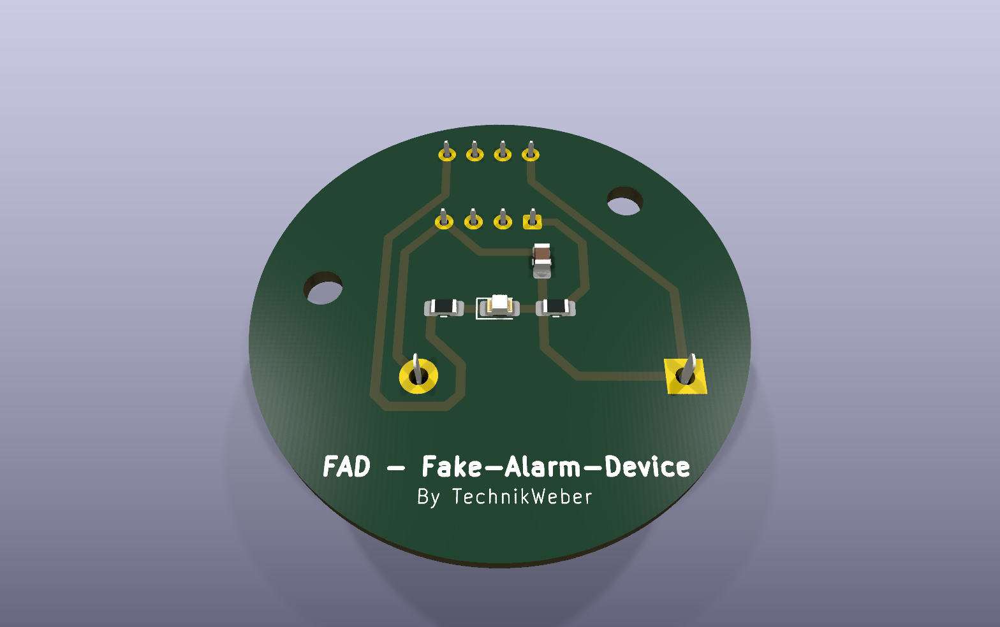

# ATtiny13A fake alarm light

<p>
  
  
  
  <a href="LICENSE"></a>
</p>

An extremely low-power gadget: an ATtiny13A flashes an LED briefly at regular intervals
to fake an armed alarm system. Running from a single CR2032 coin cell, it lasts **at
least a year**.



 

## How it works

The microcontroller spends almost all its time in power-down sleep (~4–5 µA) and is woken
by the watchdog timer: 4 s, then 1 s — 5 s in total. Then it switches the LED on for
3 ms and goes back to sleep. ADC, analog comparator, timer and the digital input buffers
are switched off; the CPU runs on the default fuses (9.6 MHz / 8 = 1.2 MHz).

## Hardware

| Part | Value / type |
|---|---|
| MCU | ATtiny13A (DIP-8 or SOIC-8) |
| Power | CR2032 (3 V) |
| Bypass capacitor | 100 nF across VCC |
| LED | any low-current LED |
| LED series resistor | 3.3 kΩ |
| Reset pull-up | 1 MΩ to VCC (instead of 100 kΩ — saves ~25 µA!) |

The KiCad project (schematic, PCB and production files) is in
[`ATTINY13A_AlarmDevice/`](ATTINY13A_AlarmDevice).

### Circuit

```
                  CR2032 (3V)
                     |
                    +++
                    | | 1 MΩ
                    +++
                     |
        +------------+------------+
        |            |            |
        |          [VCC]        [RESET] -- ATtiny13A
        |            |
       === 100 nF    |
        |          [GND]
        |            |
        +------------+
                     |
                    GND


   VCC ----[3.3 kΩ]----[LED anode]
                       [LED cathode] ---- PB0 (pin 5, ATtiny13A)
```

**Note:** the LED is active low, i.e. it lights when PB0 is pulled LOW.

### ATtiny13A pinout (DIP-8)

```
         ┌──┬──┐
   RESET │1 └ 8│ VCC
     PB3 │2   7│ PB2
     PB4 │3   6│ PB1
     GND │4   5│ PB0  ── LED
         └─────┘
```

## Firmware

In [`Firmware/`](Firmware):

| File | What it is |
|---|---|
| `raw_code.c` / `fake_alarm_5s_3ms_default.hex` | 3 ms flash every 5 s |
| `raw_code_V2.c` / `fake_alarm_5s_3ms_default_V2.hex` | Same, optimised: unused pins with pull-ups (no floating inputs), BOD off during sleep — **recommended** |

## Software requirements (Windows)

1. **avrdude:** download from <https://github.com/avrdudes/avrdude/releases>, unpack e.g. to
   `C:\avrdude\`, optionally add it to the PATH.
2. **Driver for the Diamex ISP-Prog-NG (USBasp-compatible)**, if Windows does not recognise
   the programmer: start **Zadig** (<https://zadig.akeo.ie/>) with the programmer plugged in,
   *Options → List All Devices*, select "USBasp", choose **libusbK** (or libusb-win32) →
   *Install Driver*.
3. Optional, only to compile yourself: an AVR-GCC toolchain, e.g. Zak Kemble's builds
   (<https://blog.zakkemble.net/avr-gcc-builds/>).

On Linux, `avrdude` and `avr-gcc` come from the package manager.

## Wiring programmer ↔ ATtiny13A

| Diamex ISP-Prog-NG (6-pin) | ATtiny13A pin |
|---|---|
| MISO | PB1 (pin 6) |
| VCC | VCC (pin 8) |
| SCK | PB2 (pin 7) |
| MOSI | PB0 (pin 5) |
| RESET | RESET (pin 1) |
| GND | GND (pin 4) |

> [!WARNING]
> While programming, **either** remove the CR2032 **or** switch off the programmer's target
> power — never power from both at the same time!

## Flashing

```bash
avrdude -c usbasp -p t13 -U flash:w:Firmware/fake_alarm_5s_3ms_default_V2.hex:i
```

## Fuses

The firmware runs on the **factory default fuses** — normally nothing needs to be set.
Only if a chip was configured differently:

```bash
avrdude -c usbasp -p t13 -U lfuse:w:0x6A:m -U hfuse:w:0xFF:m
```

| Fuse | Value | Meaning |
|---|---|---|
| `lfuse` | `0x6A` | internal RC 9.6 MHz, CKDIV8 on → 1.2 MHz clock |
| `hfuse` | `0xFF` | BOD off, RSTDISBL off, SPIEN on |

> [!IMPORTANT]
> BOD must be off — otherwise the chip draws ~20 µA for it alone and the battery does not
> last three months.

Read the fuses back to check (expected: `0x6a` and `0xff`):

```bash
avrdude -c usbasp -p t13 -U lfuse:r:-:h -U hfuse:r:-:h
```

## Compile it yourself

```bash
avr-gcc -mmcu=attiny13a -DF_CPU=1200000UL -Os -Wall -o fake_alarm.elf Firmware/raw_code_V2.c
avr-objcopy -O ihex -R .eeprom fake_alarm.elf fake_alarm.hex
avr-size --format=avr --mcu=attiny13a fake_alarm.elf
```

**Adjust it:** the flash length is the value in `_delay_ms(3);` (1–10 ms makes sense); the
interval comes from the two watchdog sleeps `sleep_wdt(WDT_4S); sleep_wdt(WDT_1S);` — the
watchdog offers steps from 16 ms to 8 s.

## Power budget

| State | Current |
|---|---|
| Power-down + WDT (sleep) | ~5 µA |
| LED flash (3 ms every 5 s) | ~0.2 µA average |
| 1 MΩ reset pull-up | ~3 µA |
| **Total (average)** | **~8 µA** |

With a CR2032 of ~220 mAh usable capacity:

```
220 mAh / 0.008 mA ≈ 27,500 h ≈ 3.1 years (theoretical)
```

In practice (battery self-discharge, temperature swings): **realistically 1.5–2 years**.

## Troubleshooting

| Problem | Fix |
|---|---|
| `could not find USB device` | Reinstall the Zadig driver, try another USB port |
| `target doesn't answer` | Check the wiring, slow down the programming clock: add `-B 10` |
| `signature mismatch` | Wrong chip type, bad contact, or a defective chip |
| LED does not flash after inserting the battery | Check the fuses — above all the CKDIV8 bit (lfuse bit 7 = 0) |
| Battery lasts weeks instead of months | BOD enabled? Pull-up too low? Measure the sleep current with a multimeter |
| Flash hard to see | Choose a longer flash (5 ms instead of 3 ms) |

## License

[MIT](LICENSE).
